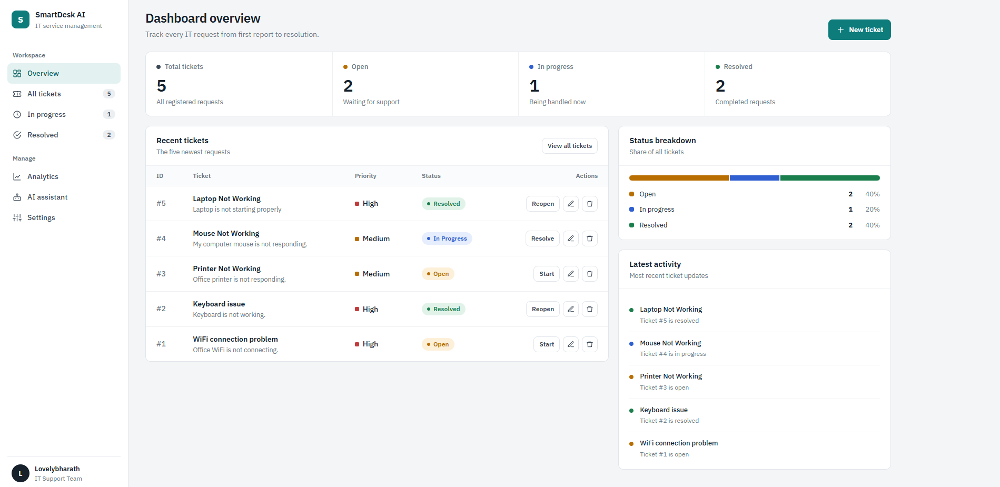

# SmartDesk AI – IT Service Management System

An AI-powered IT Helpdesk and Ticket Management System built using Python, FastAPI, SQLite, HTML, CSS, and JavaScript.

## Project Overview

SmartDesk AI is a web-based IT Service Management (ITSM) application designed to simplify IT support operations. It helps support teams create, track, update, and manage technical support tickets through an interactive dashboard.

The application also integrates a local AI troubleshooting assistant using Ollama and the Llama 3.2 model.

## Features

- Interactive IT support dashboard
- Create and manage support tickets
- Update ticket status
- Edit and delete tickets
- Search and filter tickets
- Ticket analytics and status summaries
- SQLite database integration
- REST API using FastAPI
- AI-powered troubleshooting assistant
- Responsive web interface

## Technology Stack

| Technology | Purpose |
|---|---|
| Python | Backend development |
| FastAPI | REST API framework |
| SQLite | Database |
| HTML | Frontend structure |
| CSS | UI styling |
| JavaScript | Frontend functionality |
| Ollama | Local AI integration |
| Llama 3.2 | AI language model |

## Project Structure

```text
SmartDesk-AI/
│
├── main.py
├── index.html
├── dashboard.png
├── README.md
└── .gitignore
```

## Installation and Setup

### 1. Clone the repository

```bash
git clone https://github.com/YOUR_USERNAME/SmartDesk-AI.git
cd SmartDesk-AI
```

Replace `YOUR_USERNAME` with your GitHub username.

### 2. Create a virtual environment

```bash
py -3.13 -m venv .venv
```

### 3. Activate the virtual environment

Windows CMD:

```cmd
.venv\Scripts\activate.bat
```

### 4. Install dependencies

```bash
pip install fastapi "uvicorn[standard]" requests
```

### 5. Run the application

```bash
python -m uvicorn main:app --reload
```

### 6. Open the application

Dashboard: http://127.0.0.1:8000/

API Documentation: http://127.0.0.1:8000/docs

## AI Assistant Setup

The AI troubleshooting feature uses Ollama with the Llama 3.2 model.

Install Ollama and download the model:

```bash
ollama pull llama3.2
```

Make sure Ollama is running locally before using the AI troubleshooting feature.

## Screenshots

### Dashboard Overview



## Project Goals

This project was developed to gain practical experience in:

- Python backend development
- REST API development
- Database management
- Frontend and backend integration
- Local AI integration
- Building real-world web applications

## Future Improvements

- User authentication and role-based access
- Email notifications
- Advanced ticket assignment
- Deployment to a cloud platform
- Improved AI troubleshooting capabilities

## Author

**Bharath P**

Python Developer | Backend Development | AI/ML Learner

---

If you find this project useful, feel free to star the repository!
