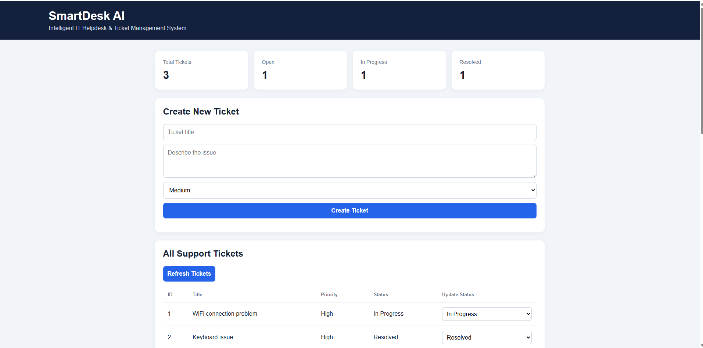

# SmartDesk AI 🤖
### Intelligent IT Helpdesk & AI-Powered Troubleshooting System

SmartDesk AI is a web-based IT helpdesk application built with Python, FastAPI, SQLite, and local AI. It helps manage support tickets and provides AI-generated troubleshooting guidance using Ollama and Llama 3.2.

## 📸 Dashboard Preview



## 🚀 Features

- Create and manage IT support tickets
- Track ticket status and priority
- View helpdesk ticket statistics
- Generate AI-powered troubleshooting suggestions
- Run AI locally using Ollama and Llama 3.2
- Store ticket information in SQLite

## 🛠️ Technologies Used

- Python
- FastAPI
- SQLite
- HTML, CSS, JavaScript
- Ollama
- Llama 3.2

## ⚙️ Requirements

- Windows, macOS, or Linux
- Python 3.10+
- Ollama
- Git (optional)

## ▶️ Installation and Setup

1. Clone the repository:

   ```bash
   git clone https://github.com/bharathbharath25052008-sketch/SmartDesk-AI.git
   cd SmartDesk-AI
   ```

2. Create a virtual environment:

   ```bash
   python -m venv .venv
   ```

3. Activate the environment on Windows:

   ```cmd
   .venv\Scripts\activate
   ```

4. Install dependencies:

   ```bash
   pip install fastapi uvicorn
   ```

5. Install Ollama from https://ollama.com and download the model:

   ```bash
   ollama pull llama3.2
   ```

6. Start the application:

   ```bash
   uvicorn main:app --reload
   ```

7. Open the dashboard:

   http://127.0.0.1:8000

API documentation:

http://127.0.0.1:8000/docs

## 📁 Project Structure

```text
SmartDesk-AI/
├── main.py
├── index.html
├── README.md
└── .gitignore
```

## 🔒 Privacy

Ticket data is stored locally in SQLite. AI troubleshooting uses a locally running Ollama model.

## 👨‍💻 Author

**Bharath P**

GitHub: https://github.com/bharathbharath25052008-sketch

## 📄 License

This project is currently shared without a specified open-source license.